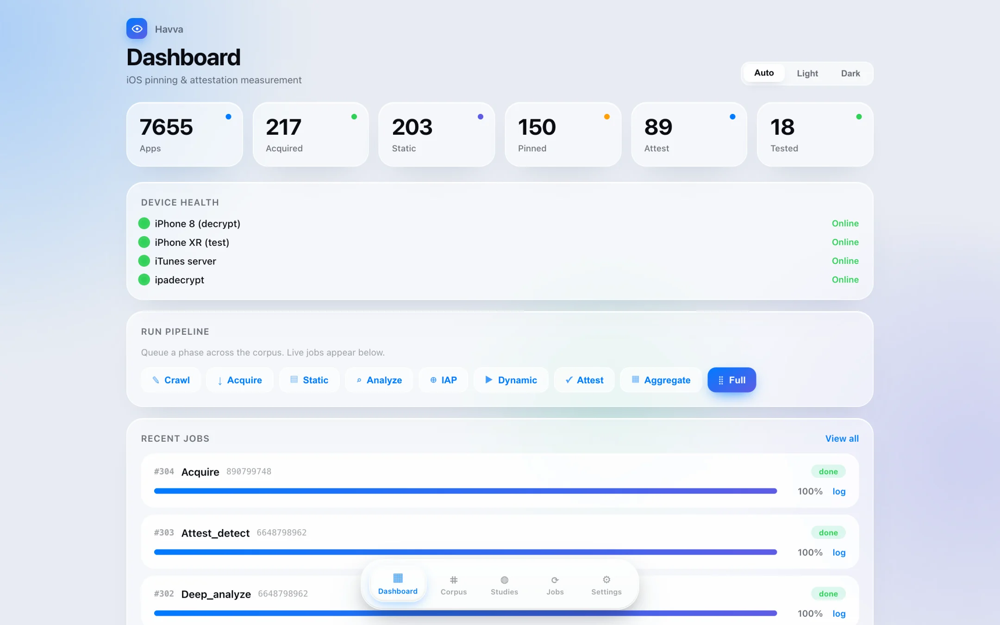
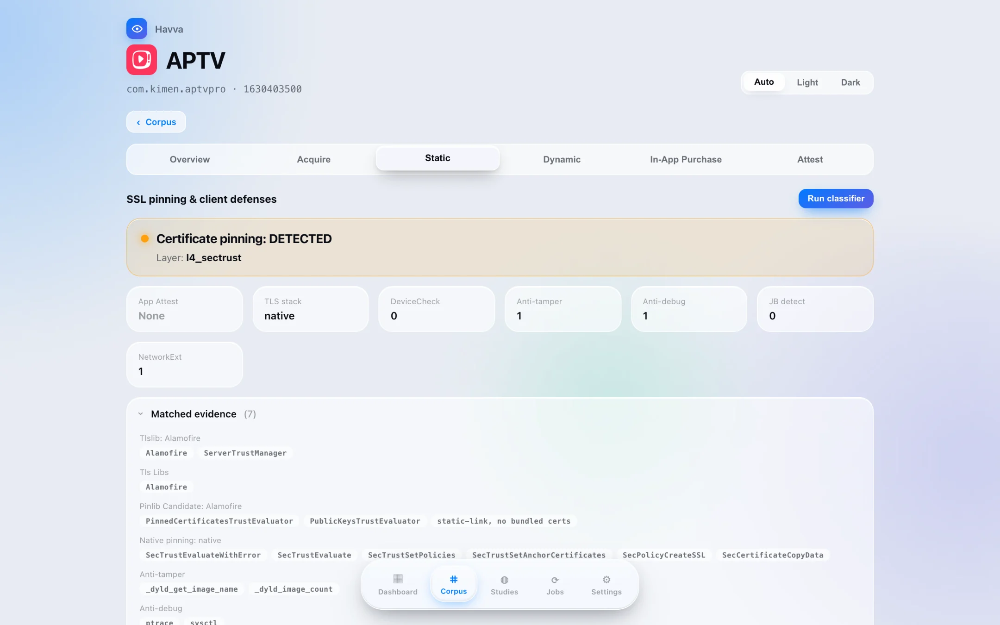
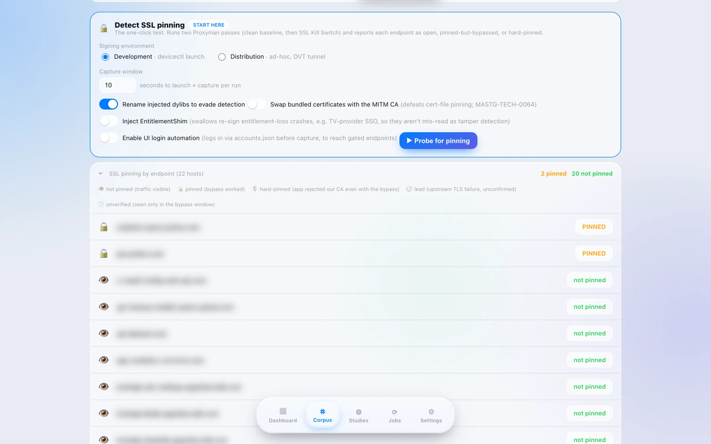
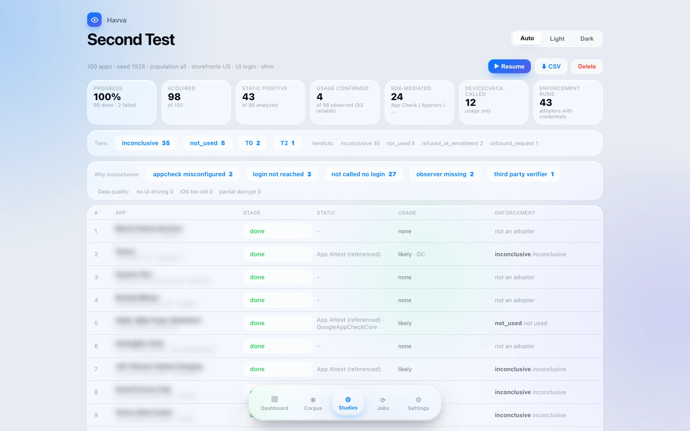
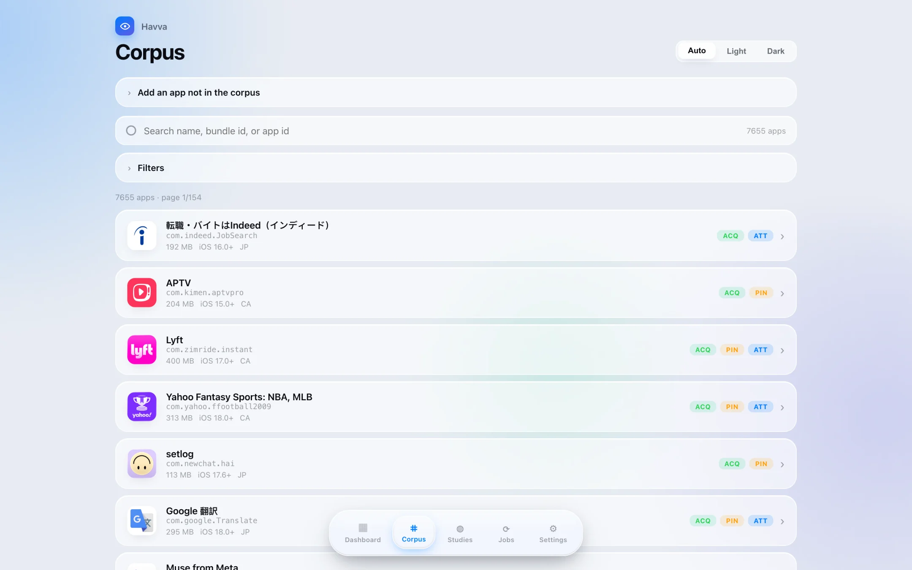
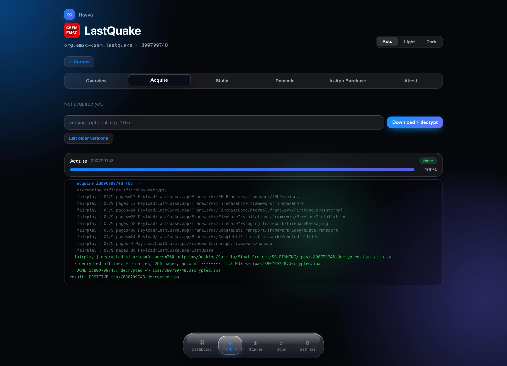
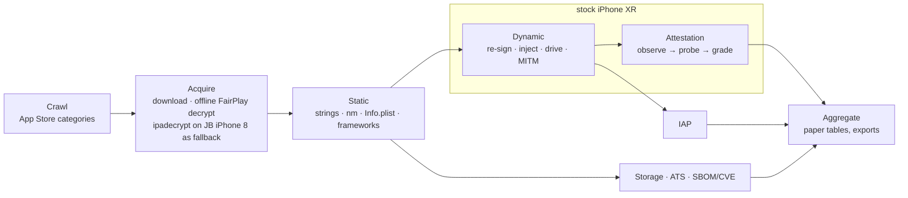

<div align="center">


# Havva

**At-scale measurement of iOS client-integrity defenses: do they merely exist, or do they actually hold?**

    

<code>SSL pinning</code> · <code>App Attest / DeviceCheck</code> · <code>in-app purchase validation</code> · <code>sideload / anti-tamper</code> · <code>App Transport Security</code> · <code>on-device storage</code> · <code>SBOM + CVEs</code>

<br>

<picture>
  <source media="(prefers-color-scheme: dark)" srcset="docs/screenshots/dashboard-dark.webp">
  
</picture>

<sub>The screenshot follows your GitHub theme. Wherever a screenshot shows per-app measurement results, app names and hostnames are blurred: those results are unpublished research data.</sub>

</div>

---

Havva is a research pipeline that takes thousands of App Store apps from a category crawl all the way to a per-app, evidence-backed verdict on each client-side defense. It runs against real, physical iPhones (one jailbroken for decryption, one stock for honest measurement), drives apps through their login flows automatically, man-in-the-middles their traffic, and grades every defense as **effective**, **present-but-ineffective**, **absent**, or **inconclusive**. Every verdict carries the artifact that justifies it: the HAR, the crash report, the decompiler hit, the frida hook log.

The central thesis the tool is built around: **presence is not effectiveness.** An app can link a pinning library and never pin. It can call App Attest on every launch and never refuse a request that lacks an assertion. It can ship StoreKit and validate receipts against a deprecated endpoint anyone can forge. Havva measures the gap.

A FastAPI + HTMX console ("Havva" proper) sits on top of the whole thing so a run can be started, watched live, stopped, and browsed from a phone on the same Wi-Fi.

## Highlights

- **Verdicts, not keyword hits.** Every defense is graded effective, present-but-ineffective, absent or inconclusive, and every grade points at the evidence behind it.
- **Real hardware, end to end.** A jailbroken iPhone 8 handles decryption and a stock iPhone XR does the measuring, so jailbreak detection never contaminates a verdict.
- **Offline FairPlay decryption (new).** Downloaded IPAs are decrypted on the Mac in seconds from one credential per Apple account. The install, launch and dump round trip on the device is now only a fallback.
- **Hands-off logins.** An accessibility-tree navigator, a text-only LLM fallback and SMS one-time-code retrieval get apps past onboarding and sign-in without per-app scripts.
- **An App Attest enforcement battery.** Omit, tamper, bind, replay, noreg and downgrade probes, each graded against a baseline that proves the endpoint really serves gated data.
- **A live console and seeded studies.** Start any phase from the browser, watch color-coded logs stream in, and run reproducible random-sample campaigns with live statistics.

## A look inside

<table>
  <tr>
    <td width="50%" valign="top">
      <picture>
        <source media="(prefers-color-scheme: dark)" srcset="docs/screenshots/static-analysis-dark.webp">
        
      </picture>
      <br><b>Static analysis.</b> Pinning detected, plus the exact evidence behind the call: trust evaluators, native <code>SecTrust</code> APIs, anti-tamper and anti-debug markers.
    </td>
    <td width="50%" valign="top">
      <picture>
        <source media="(prefers-color-scheme: dark)" srcset="docs/screenshots/dynamic-pinning-dark.webp">
        
      </picture>
      <br><b>Dynamic pinning probe.</b> A clean proxy pass and an SSL Kill Switch pass, graded per endpoint as not pinned, pinned-but-bypassed or hard-pinned.
    </td>
  </tr>
  <tr>
    <td width="50%" valign="top">
      <picture>
        <source media="(prefers-color-scheme: dark)" srcset="docs/screenshots/study-dark.webp">
        
      </picture>
      <br><b>Studies.</b> A seeded 100-app campaign: the adoption funnel, enforcement tiers, and the reason behind every inconclusive result.
    </td>
    <td width="50%" valign="top">
      <picture>
        <source media="(prefers-color-scheme: dark)" srcset="docs/screenshots/corpus-dark.webp">
        
      </picture>
      <br><b>Corpus.</b> Thousands of crawled apps across storefronts, each badged by what has been done to it: acquired, pinning, attestation.
    </td>
  </tr>
</table>

## Offline FairPlay decryption

<p align="center">
  
</p>

Acquire used to decrypt every app by installing it on the jailbroken iPhone 8, launching it and dumping it from memory. It now decrypts the downloaded IPA on the Mac with [fairplay-decrypt](https://github.com/EthanArbuckle/fairplay-decrypt), which derives the page keys from the IPA's own SINF and SUPF license records plus a 16-byte credential for the Apple account that owns it. Nothing is installed or launched.

| | |
|---|---|
| **Correctness** | Byte-identical to the ipadecrypt output on every binary compared: 2 of 2 in one app, 25 of 25 in another. |
| **Speed** | Decryption took 0.6 s for an 8 MB app and 3.3 s for a 93 MB app. A full acquire of a small app (download, decrypt, verify, record) finished in under 3 s. |
| **Scope** | One credential per Apple account covers every app that account downloads. |
| **Safety net** | Output is accepted only if no image the app needs at launch is still encrypted. Otherwise, or when an account has no credential, ipadecrypt runs exactly as before. |

Set it up once:

```bash
# the tool has no upstream license, so it is cloned at a pinned commit rather than vendored (gitignored)
git clone https://github.com/EthanArbuckle/fairplay-decrypt tools/fairplay-decrypt
git -C tools/fairplay-decrypt checkout 0c952e15a705bf240a8ba6949c9e051b76624bdc
make -C tools/fairplay-decrypt

# once per Apple account: pass any ENCRYPTED IPA that account downloaded (e.g. via ipatool)
python3 -m pipeline.cli fairplay-credential --ipa path/to/encrypted.ipa
python3 -m pipeline.cli doctor        # "Offline FairPlay ... used by acquire: yes"
```

It applies when `ACQUIRE_MODE` is `appstore` or `ipatool`, the modes that stage the encrypted IPA locally. Retrieval details and caveats are under [Acquire](#acquire).

## Contents

- [Highlights](#highlights)
- [A look inside](#a-look-inside)
- [Offline FairPlay decryption](#offline-fairplay-decryption)
- [What it measures](#what-it-measures)
- [How a run flows](#how-a-run-flows)
- [The lab](#the-lab)
- [Install](#install)
- [Configuration](#configuration)
- [Running it](#running-it)
- [The web console](#the-web-console)
- [Stage by stage](#stage-by-stage)
- [Injected dylibs](#injected-dylibs)
- [Login automation](#login-automation)
- [Measurement validity](#measurement-validity)
- [Failure taxonomy](#failure-taxonomy)
- [Repository layout](#repository-layout)
- [Tests and audit](#tests-and-audit)
- [Research context](#research-context)
- [Responsible use](#responsible-use)

## What it measures

| Dimension | Static signal | Dynamic truth | Verdict space |
|---|---|---|---|
| **TLS certificate pinning** | pinning libraries, `NSPinnedDomains`, hand-rolled trust evaluators, configuration-based pins | app re-signed, SSL Kill Switch injected, traffic observed through a MITM proxy; escalation ladder of bypass rungs | `effective`, `ineffective`, `absent`, `inconclusive` |
| **App Attest / DeviceCheck** | `DCAppAttestService` symbols, entitlement, DeviceCheck tokens (counted separately), attestation SDKs and App Check provider | hooks observe real calls (and `isSupported`); attested requests found by CBOR content fingerprint and hook timing; probes tamper (signature only), omit, bind (F3), replay (F4), noreg, downgrade, with response diffing against the baseline | `ENFORCED`, `SOFT_DEGRADED`, `PARTIAL_COVERAGE`, `SIGNATURE_NOT_VERIFIED`, `NOT_REQUIRED`, `UNBOUND_REQUEST`, `REPLAYABLE`, `NOT_REGISTERED_OK`, `DOWNGRADEABLE`, `INCONCLUSIVE` |
| **In-app purchase** | StoreKit 1 vs 2 generation, deprecated `verifyReceipt` hosts, on-device PKCS#7 receipt parsing, managed IAP SDKs, shipped `.storekit` configs | MITM replay of validation responses (paper-1 methodology) | risk `high` / `medium` / `low` / `info`, with the validation path named |
| **Sideload / anti-resign** | integrity SDK markers (IOSSecuritySuite, FreeRASP), jailbreak and debugger checks | plain re-sign vs SideloadFix launch pair with liveness polling; crash reason and intent read from the `.ips`; EvasionKit neutralization rung | `no_detection`, `resign_fragile`, `anti_resign`, `anti_resign_unrecovered`, `entitlement_crash`, `resign_broken`, `blocked_unrecovered`, `inconclusive` |
| **App Transport Security** | `NSAppTransportSecurity` exceptions and their blast radius | runtime cleartext observation with tri-state `exception_effect` | per-exception effect |
| **On-device storage** | storage API hints (NSUserDefaults, SQLite, Realm, weak Keychain accessibility) | drive through login with StorageObserver injected (per-file Data Protection class, Keychain accessibility), pull the container, scan plists, SQLite with WAL applied, cookies | `credentials_exposed`, `tokens_in_files`, `pii_in_files`, `data_only`, `clean`, `inconclusive` |
| **SBOM / CVEs** | embedded frameworks and SDK versions | n/a | per-dependency CVE list |

## How a run flows



Every stage is a resumable, tri-state work queue over a single SQLite database (`pinning.db`): an app is either not yet processed, processed, or failed-with-reason, and re-running a stage only touches what it has not finished. Nothing is ever silently coerced into a verdict; if the evidence is missing, the row says so.

## The lab

Havva is built for a concrete bench:

| Role | Hardware | Why |
|---|---|---|
| **Decryption** | jailbroken iPhone 8, reachable over SSH | static analysis needs decrypted Mach-Os; the device supplies one FairPlay credential per Apple account for offline decryption on the Mac, and `ipadecrypt` dumps apps on-device as the fallback |
| **Measurement** | stock, non-jailbroken iPhone XR | apps are re-signed with a developer certificate and launched with injected dylibs; no jailbreak means no jailbreak-detection confound |
| **Automation** | Appium + WebDriverAgent over the XCUITest driver | taps, types, reads the accessibility tree, auto-accepts system alerts |
| **Interception** | Proxyman (HAR export) on the Mac | the stock device trusts the proxy CA; pinned apps are the ones that refuse it |
| **Decision support** | Jev (TypeSafe AI), text-only | picks the next control when the heuristic navigator stalls on an onboarding screen |

The two-device split is deliberate. Decryption needs a jailbreak; measurement must not have one, otherwise every anti-tamper verdict is contaminated.

## Install

```bash
git clone https://github.com/AmirhosseinKhanlari/Havva.git
cd Havva
pip install -r requirements.txt
cp .env.example .env            # then fill it in (see Configuration)
python3 -m pipeline.cli doctor  # checks ipatool, ipadecrypt, codesign, Appium, frida, proxy
python3 -m pipeline.cli status  # DB counts and stage readiness
```

External tools (all invoked as subprocesses, never vendored): `ipatool`, [`fairplay-decrypt`](https://github.com/EthanArbuckle/fairplay-decrypt) for offline decryption (cloned and built under `tools/`, see [Offline FairPlay decryption](#offline-fairplay-decryption)), `ipadecrypt` (bootstrapped onto the jailbroken device with `./tools/ipadecrypt bootstrap`), Xcode command-line tools (`codesign`, `xcodebuild` for WDA), `libimobiledevice` (`idevicesyslog`, `ideviceinstaller`), Appium 2 with the XCUITest driver, `frida-tools`, Proxyman, and optionally Hopper for the manual deep-dives.

The tweaks under `tweaks/` build with Theos; prebuilt copies of our own dylibs are checked in at the repository root so a fresh clone can run without a Theos toolchain.

## Configuration

All configuration is read from `.env` (never committed). The variables the code actually reads:

| Group | Variables |
|---|---|
| Crawl | `CRAWL_COUNT_PER_CATEGORY`, `ITUNES_SERVER` |
| Acquire | `ACQUIRE_MODE`, `IPATOOL_CMD`, `IPATOOL_EMAIL`, `IPATOOL_PASSWORD`, `IPADECRYPT_CMD`, `DECRYPT_SSH_HOST`, `DECRYPT_SSH_PORT`, `DECRYPT_SSH_USER` |
| Offline FairPlay | `FAIRPLAY_OFFLINE` (default `1`), `FAIRPLAY_DECRYPT_DIR` (default `tools/fairplay-decrypt`), `FAIRPLAY_CREDENTIALS_DIR` (default `~/.fairplay-decrypt/credentials`, outside the repo), `FAIRPLAY_ROOT_KEY` (root SSH key on the jailbroken device, used only for credential retrieval) |
| Measurement device | `TEST_DEVICE_UDID`, `TEST_DEVICE_IP`, `MONITOR_SECONDS`, `PROXYMAN_PORT` |
| Signing | `SIGN_ENV`, `SIGN_P12_PASSWORD`, `SIGN_DEV_P12_PASSWORD` |
| Injection | `DYLIB_SSKS`, `DYLIB_SSKS_ALIAS`, `DYLIB_SIDELOADFIX`, `DYLIB_FRIDA`, `DYLIB_FRIDA_ALIAS` |
| Automation | `APPIUM_ENABLED`, `APPIUM_URL`, `APPIUM_TEAM_ID`, `APPIUM_SIGNING_ID`, `APPIUM_WDA_BUNDLE` |
| LLM fallback | `JEV_API_KEY`, `LLAMA_PROVIDER`, `LLAMA_API_KEY`, `OLLAMA_URL`, `OLLAMA_MODEL` |
| Web console | `WEB_AUTH_TOKEN`, `WEB_HOST` (default `0.0.0.0`), `WEB_PORT` (default `8770`), `WEB_MAX_WORKERS` (default `3`), `WEB_RELOAD` |

Test-account credentials for login automation live in `results/accounts.json` (gitignored), keyed by App Store id with a `"*"` wildcard entry. OTP delivery uses a Gmail API token for a Google Voice forwarding mailbox, also under `results/`.

## Running it

Each stage is a CLI subcommand. Run them in order the first time; after that, any of them alone.

```bash
python3 -m pipeline.cli crawl              # App Store category listings → apps table
python3 -m pipeline.cli acquire            # download, decrypt (offline FairPlay, else on the JB device), store the IPA
python3 -m pipeline.cli static             # all static analyzers (pinning, ATS, attest, IAP, SBOM, storage)
python3 -m pipeline.cli dynamic            # re-sign + inject + drive + MITM, with the bypass ladder
python3 -m pipeline.cli attest             # App Attest enforcement probes (observe → probe → grade)
python3 -m pipeline.cli attest-detect      # observation-only hook run (usage, not enforcement)
python3 -m pipeline.cli iap                # IAP dynamic check
python3 -m pipeline.cli aggregate          # paper tables
python3 -m pipeline.cli export             # CSV / JSON dumps
```

Targeted single-purpose commands also exist: `fairplay-credential` (provision or list offline-decryption credentials), `analyze` (one app, verbose), `detect-pinning`, `detect-sideload`, `inspect-storage`, `iap-bypass`, `ats-gap`, `sbom`, `dep-stats`, `backfill-bundles`. Run `python3 -m pipeline.cli --help` for the full list and `python3 -m pipeline.cli <cmd> --help` for flags such as `--app`, `--limit`, `--dylibs`, `--entshim`, `--evade`.

## The web console

```bash
# in .env: WEB_AUTH_TOKEN=<long random string>
python3 -m pipeline.cli web          # http://<mac-ip>:8770
```

- **Corpus** view: the funnel counts, per-stage queues, filters by verdict.
- **App detail** with tabs per dimension (Static, Dynamic, Attest, IAP, Storage, ATS). Each tab has its own *Run* button, dylib selector, and a live color-coded console streamed over SSE straight from the pipeline loggers of that job only (log lines are attributed by thread lineage so concurrent jobs never bleed into each other).
- **Jobs** page: queue, progress, cancel. Device-bound stages serialize on a single device lock; *Stop* terminates the external helpers (WDA build, syslog capture) the running job is blocked in, and only for the job that actually holds the device.
- **Settings**: device liveness, tool presence, DB maintenance.
- Templates hot-reload; Python changes need a restart (`WEB_RELOAD=1` turns on uvicorn reload for development).

The console only calls the same pipeline functions the CLI does. There is no second code path.

## Stage by stage

### Crawl
Pulls the top apps per App Store category from the iTunes search and lookup APIs. Records bundle id, developer, price, and the store's *offers in-app purchases* flag, which later stages treat as **corroborating, never authoritative** (it is a frequent false negative in practice).

### Acquire
The encrypted IPA is downloaded under the lab Apple ID, either through the MZStore protocol via an iTunes server (`ACQUIRE_MODE=appstore`, which can also fetch older builds) or with `ipatool`. Two decryptors are then tried in order:

1. **Offline FairPlay** (`pipeline/fairplay.py`). The account that owns the IPA is read from its SINF `user` field. If a credential exists for that account, [fairplay-decrypt](https://github.com/EthanArbuckle/fairplay-decrypt) decrypts every encrypted arm64 binary on the Mac into a temporary file. The result is moved into place only if `verify_decrypted` finds no launch-critical image with `cryptid != 0`; a partial or failed attempt never leaves a file behind.
2. **ipadecrypt** (fallback). It installs the IPA on the jailbroken iPhone 8, dumps the decrypted main binary and embedded frameworks, and repackages. The stage streams the decryptor's log into the console line by line, recognizes the `MismatchedApplicationIdentifierEntitlement` case (an earlier re-signed copy of the same app is installed under the lab team), uninstalls that copy exactly by bundle id, and retries once.

With a credential in place the iPhone 8 is no longer needed per app, so acquire only requires the device when an IPA's account has no credential. Permanent failures (region-locked, removed, paid) are anchored and never retried; transient ones keep an attempt counter.

**Credentials.** `pipeline.cli fairplay-credential --ipa <encrypted.ipa>` retrieves the credential for that IPA's account from the jailbroken device, decrypts the IPA with it as a self-test, and only then stores it (mode `0600`) under `~/.fairplay-decrypt/credentials/<account>.bin`, outside the repository. `--import <credential.bin>` stores an existing credential after the same self-test, and `--list` shows what is provisioned. Retrieval needs root SSH by key on the device (on a rootless jailbreak root's home is `/var/jb/var/root`, not `/var/root`), at least one App Store app of that account installed on it, and it restarts the device's `fairplayd` once. It works over Wi-Fi: the device UDID is read on the device itself rather than through `idevice_id`. Each storefront account (US, GB, ...) needs its own credential; until then its apps go through ipadecrypt.

### Static
Operates on the decrypted Mach-O plus `Info.plist` and the bundle listing, and never on a capped file tree:

- **Pinning**: libraries (TrustKit, AFNetworking/Alamofire evaluators, OkHttp-style pins in cross-platform runtimes), `NSPinnedDomains`, and hand-rolled `SecTrustEvaluate` paths. Reports *library present* and *pinning configured* as different facts.
- **App Attest**: `DCAppAttestService` symbols and the entitlement; DeviceCheck is reported in its own field. Static says *adopted*; only the dynamic stage can say *enforced*.
- **IAP** (`pipeline/iap_static.py`): StoreKit generation (1, 2, both, SDK-only), the validation path (`server-apple-api`, `storekit2-jws`, `sdk`, `client-verifyreceipt`, `on-device-receipt`, `unknown`), and non-IAP StoreKit uses (reviews, promotion, ads) kept out of the IAP decision. Evidence is strength-gated: SK1 class names alone are *latent*; a deprecated `verifyReceipt` full host, a managed SDK, the App Store Server API, or a strong StoreKit 2 token is *active*.
- **ATS**: every exception, its scope, and whether the runtime actually exercised it.
- **Storage**: static API hints only; the real check is the dynamic probe, which drives the app through login with StorageObserver injected and then pulls and scans the container.
- **SBOM / CVE**: embedded frameworks with versions, matched against known CVEs.

### Dynamic
1. **Re-sign** the IPA with the lab developer certificate. Entitlements that the re-sign necessarily strips can make the app throw at launch; `EntitlementShim` (below) catches exactly those exceptions so the crash is not misread as anti-tamper.
2. **Inject** the selected dylibs (see the catalog), under innocuous names when evasion is on, and validate every requested dylib id up front.
3. **Drive** with Appium: reach the login screen, authenticate with a lab account, exercise the app for a monitoring window, while `idevicesyslog` captures the device log and the proxy records traffic.
4. **Observe** liveness tri-state (running, died, unknown), attribute crashes to the exact `.ips` report for this launch (no `-k` fuzzing), and export the HAR only after unlinking the previous one so a stale file is never re-read. The drive runs under a device syslog capture: when the app rejects the proxy certificate, CFNetwork and BoringSSL log it under the app's process name, which is the only direct, process-attributed evidence of pinning (the proxy sees nothing). Only TLS flows count as hosts; cleartext is reported separately.
5. **Escalate** through the bypass ladder (baseline → SSL Kill Switch → SideloadFix → EvasionKit → frida) until the app's own traffic appears in the proxy. A crash *under* a bypass rung is `INCONCLUSIVE`, never a bypass success. Apple's own traffic (push, iCloud, telemetry) is excluded before "reached any network" is computed.

### Attestation
The stage follows Apple's own guidance on what enforcement means: the server must **refuse** a request whose attestation is missing or wrong.

1. **Baseline** drive with the `AttestObserver` hooks only: records which endpoints return gated data with a well-formed assertion.
2. **Probes**, each a persistent frida script that reports `ARMED` and `HIT` markers so a hook that never fired is distinguishable from a server that did not care: `tamper` (corrupt the assertion), `omit` (strip it), `noreg` (skip key registration), `downgrade` (fall back to DeviceCheck).
3. **Grade** tri-state per probe (`served`, `refused`, `undetermined` with a reason) against the baseline's gated endpoints. `ENFORCED` requires that both `tamper` and `omit` were *definitively* refused. Partial refusal is `SOFT`; served-under-tamper is `ADOPTED_NOT_ENFORCED`; a probe that never armed is `INCONCLUSIVE`.

The verdict row stores the per-probe reasons as JSON so the paper can report *why* each app landed where it did.

### Aggregate / export
Builds the funnel and verdict tables used in the papers and exports CSV/JSON. Numbers are derived from the DB at run time, never typed in.

## Injected dylibs

All loadable copies live at the repository root; sources for ours are under `tweaks/`.

| id | file (alias when evasion is on) | purpose | origin |
|---|---|---|---|
| `ssks` | `SSLKillSwitch2.dylib` (`libAudioBridge`) | disables TLS trust evaluation so the proxy sees pinned traffic | SSL Kill Switch 2 |
| `sideloadfix` | `sideloadFixerLol.dylib` (`libMobileBridge`) | neutralizes common re-sign / sideload checks | SideloadFix |
| `frida` | FridaGadget (`libServiceBridge` family) | script-driven hooks for probes | frida |
| `evasion` | `EvasionKit.dylib` (`libSystemBridge`) | hides injected images from `dyld` enumeration, bounds `ptrace`/`sysctl` anti-debug, remaps header/slide, `csops` flags; strictly measurement hygiene | ours, `tweaks/EvasionKit` |
| `attest` | `AttestObserver.dylib` (`libServiceBridge`) | install-once hooks on `DCAppAttestService` and DeviceCheck that log every call, key id, and assertion to syslog | ours, `tweaks/AttestObserver` |
| `storageobs` | `StorageObserver.dylib` (`libDataBridge`) | logs every container file's Data Protection class and the app's Keychain items with their accessibility class, names only, never values | ours, `tweaks/StorageObserver` |
| `entshim` | `EntitlementShim.dylib` (`libAccountBridge`) | constructor-time swizzle of the app delegate and scene delegates, wrapping entry points in `@try/@catch` trampolines that swallow *only* `NSException`s whose reason names a missing entitlement | ours, `tweaks/EntitlementShim` |

`EntitlementShim` exists because of a real false positive: a major streaming app crashed on every re-signed launch and looked like anti-tamper. The crash report showed an uncaught exception from a video-subscriber framework demanding an entitlement the re-sign had stripped, turned into `abort()` by a crash-reporting SDK's uncaught-exception handler. Wrapping the delegate let the app run and be measured. The shim is generic (env `ENTSHIM_TARGETS`, `ENTSHIM_MATCH_ALL`) and available as a toggle on every dynamic and attestation run.

Design rules learned the hard way, enforced in the sources: never do Objective-C work inside a `_dyld_register_func_for_add_image` callback (loader-lock deadlock); use a class-only lookup and `class_addMethod` overrides so the original delegate is never re-entered; keep a bounded registry so swizzles do not grow unbounded across scenes.

## Login automation

Most measurement happens behind a login wall, so Havva reaches it without per-app scripts and without a vision model.

- **Accounts**: email/password, Google SSO, or phone number per app, from `results/accounts.json`.
- **Navigator**: a heuristic over the XCUITest accessibility tree. Labels are normalized (bidi marks such as U+200E stripped), `Button` and `Link` elements are matched first by substring, `StaticText` only exactly, with a priority and negation list (*Agree and continue*, *Start messaging*, *Log in* beat *Create account*; *Not now* beats *Allow*). Phone screens are handled with split country-code / national-number fields and are cleared before typing.
- **Loop**: method → go to login → skip onboarding → LLM advance → swipe, with a minimum observation window and a goal check after every step.
- **Jev fallback** (`pipeline/llm_driver.py`): when the heuristic has no confident move, the control list of the current screen (text only) is sent to Jev with a single *forward progress toward sign-in* question; the answer is validated against the real control set before it is tapped. This resolved onboarding carousels that the heuristic kept swiping past.
- **OTP**: codes arrive by SMS on a Google Voice number, forwarded to a Gmail mailbox, read through the Gmail API with the Voice boilerplate, URLs, and phone numbers stripped before the code regex runs. Some messengers refuse to send SMS to VoIP numbers; those apps are flagged rather than retried.

Known limitation: at least one dating app refuses to run re-signed at all; it is excluded from dynamic runs by configuration rather than by special-casing in code.

## Measurement validity

These rules run through the whole codebase and were tightened in the October 2026 audit (`docs/audit-2026-10-18.md`):

- **Tri-state everywhere.** Liveness, probe outcomes, ATS exception effect, pinning effectiveness: *unknown* is a first-class answer with a reason, never collapsed into *no*.
- **Baseline first.** No probe is interpreted without a baseline that proves the endpoint serves gated data when the assertion is good.
- **Armed before hit.** A hook that did not install cannot produce a verdict about the server.
- **Fail-safe grading.** `ENFORCED` is the hardest verdict to earn and needs two independent, definite refusals. Everything ambiguous degrades toward `INCONCLUSIVE`, never toward the headline number.
- **Confounds are named.** Re-sign entitlement loss, Apple's own background traffic, stale HAR and crash files, DeviceCheck versus App Attest, library presence versus configured pinning: each has an explicit guard and a test.
- **Evidence strength.** Static IAP and attest signals are tiered (strong / generic / latent) so a linked framework does not become a finding.
- **Exact attribution.** Crash reports are matched to the launch by bundle id and timestamp; uninstalls are by exact bundle id from `plutil`; cancel only kills the helpers of the job holding the device.

## Failure taxonomy

For apps whose dynamic measurement did not produce the targeted traffic, the pipeline records *why*, so a negative is never reported as *not vulnerable*:

| reason | meaning |
|---|---|
| `ssl_pinning` | app traffic never reached the proxy under baseline, bypass rung needed or failed |
| `login_wall` | no relevant traffic within the window and a login screen was still up |
| `resign_blocked` | app refuses to run re-signed (anti-tamper or entitlement loss) |
| `crash_other` | crashed for a reason attributed to something other than our injection |
| `no_feature_traffic` | ran fine, feature simply not exercised in the window |
| `tool_error` | our side: WDA, proxy, device, decrypt |

The same taxonomy was used to re-classify the untested share of a prior corpus for reviewer follow-up (`iap_untested_subs.db` is produced locally, not committed).

## Repository layout

```
pipeline/
  cli.py               subcommands; the only entry point besides the web app
  config.py            .env loading (no secret fallbacks)
  db.py                SQLite schema, tri-state queues, jobs table
  crawl.py             App Store category crawl
  acquire.py           download, offline-first decrypt with ipadecrypt fallback, autoremove, attempt accounting
  fairplay.py          offline FairPlay: SINF account id, credential store, decrypt, credential retrieval
  analysis.py          static pinning / evidence blob (strings + nm)
  static_classify.py   configuration-based pinning classification, attest entitlement/symbols
  iap_static.py        StoreKit generation + validation-path detector
  iap.py / iap_bypass.py   App Store IAP flag, dynamic IAP checks
  attest_detect.py     App Attest usage observation
  attestation.py       enforcement probes, tri-state grading
  dynamic.py           re-sign/inject/drive/MITM orchestration, bypass ladder
  instrument.py        dylib catalog, injection, re-signing
  device.py            Appium driver, navigator, liveness, crash attribution
  llm_driver.py        Jev text-only decision fallback
  otp.py               Gmail / Google Voice OTP reader
  capture.py           HAR export + flow classification (Apple traffic excluded)
  escalate.py          .ips parsing, sideload/anti-tamper attribution
  ats_runtime.py, storage_scan.py, cve.py, aggregate.py, util.py, vpn.py
  web/                 FastAPI app, auth, job manager, HTMX templates, routers
scripts/               frida probe scripts (attest_*.js), helpers
tweaks/                Theos sources: AttestObserver, EvasionKit, EntitlementShim, AttestControlApp
tests/                 pytest suite (396 tests)
docs/                  audit record, paper drafts (threat model, system-model figure), README screenshots
tools/fairplay-decrypt offline decryptor, cloned at a pinned commit (gitignored, never committed)
*.dylib                prebuilt loadable copies (ours and third-party)
```

Gitignored on purpose: `.env`, `results/` (accounts, OTP tokens, exports), `ipas/`, `work/`, `logs/`, every `*.db` and backup, `*.ipa`, `*.har`, `tools/fairplay-decrypt/`, and vendored reference repositories. FairPlay credentials are kept outside the repository entirely.

## Tests and audit

```bash
pytest -q        # 396 passed
```

The suite covers the offline-decryption decision (offline first, discard of still-encrypted output, fallback, device-offline handling, credential store guards), the grading logic (tri-state attest grades, probe outcome rules, `client_assertion` is not an attestation header), static classifiers against synthetic binaries, HAR classification, `.ips` parsing, liveness, job cancellation scoping, log isolation, and the web routes. A full implementation audit with every finding and its fix is recorded in `docs/audit-2026-10-18.md`; the items still awaiting on-device validation (rebuilt enforcement probe, EntitlementShim scene net, EvasionKit remap) are listed there explicitly.

## Research context

- The IAP methodology descends from the USENIX Security 2027 paper on iOS subscription validation attacks; the static detector here is its successor, rewritten for precision.
- The attestation stage implements the adopt-versus-enforce distinction for App Attest and DeviceCheck; the threat model and the system-model figure draft live in `docs/paper/`.
- The pinning stage separates *library present* from *pinning effective* after decompiling apps that link a pinning library and never configure it.

## Responsible use

Havva is for authorized measurement research. Apps are measured, not attacked: the lab accounts are researcher-owned, no third-party data is accessed, and responsible disclosure applies to anything found. Turnkey per-app exploitation rules are not part of this repository. Evasion is capped at measurement hygiene (avoid trivially detecting the lab, report the residue) and is never an attempt to defeat enforced attestation. Decrypted binaries, captured traffic, credentials, and databases never leave the machine and are never committed. Offline FairPlay decryption only ever uses credentials of researcher-owned lab accounts, on IPAs those accounts downloaded; the decryptor itself is not redistributed here.
